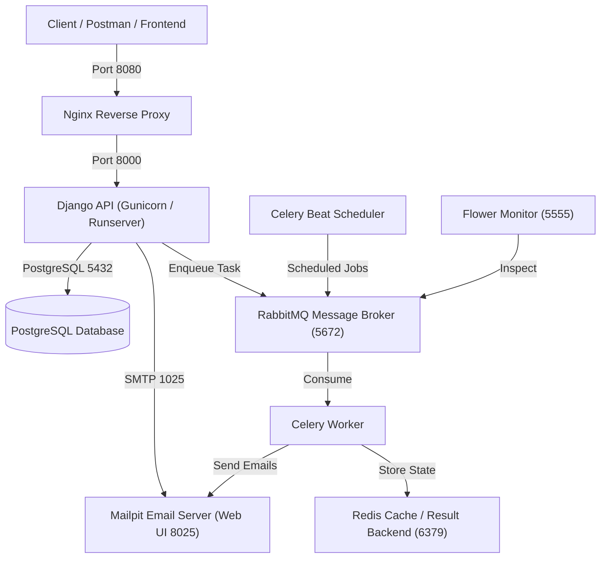
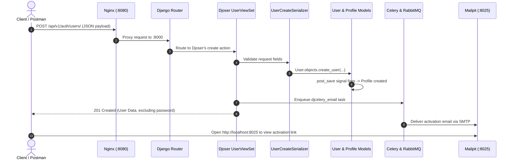
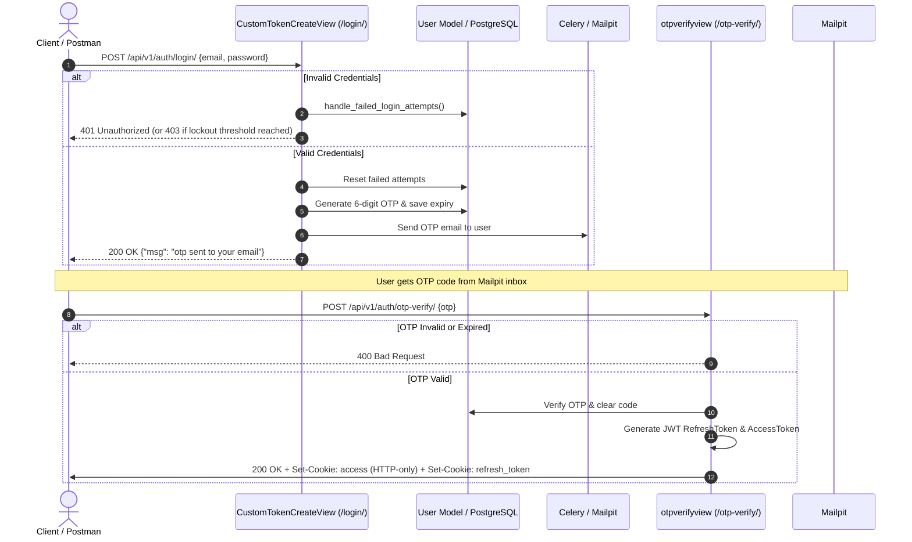
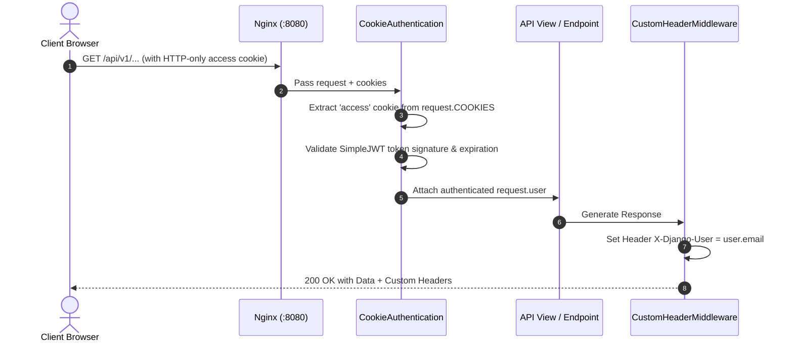

# NextGen Bank — Architecture & Code Flow Documentation

## 1. System Overview & Technology Stack

The **NextGen Bank** project is an enterprise-grade banking backend built with **Django 5.0** and **Django REST Framework (DRF)**. It employs a modular architecture with containerized micro-services orchestrated via **Docker Compose**.



### Key Technologies:
* **Framework**: Django 5.0.14 & Django REST Framework
* **Database**: PostgreSQL 16
* **Authentication**: Djoser + Django REST Framework SimpleJWT + Custom Cookie Authentication (HTTP-only)
* **Asynchronous Task Queue**: Celery + RabbitMQ + Redis
* **Task Monitoring**: Flower (Web Dashboard on `:5555`)
* **Email Testing**: Mailpit (Web UI on `:8025`, SMTP on `:1025`)
* **Logging**: Loguru + Custom logging interceptor (`interceptor.py`)
* **API Documentation**: OpenAPI 3 schema via `drf-spectacular` (Swagger UI on `:8080/api/v1/swagger/`)
* **Media Storage**: Cloudinary (for profile photos, KYC ID photos, signatures)

---

## 2. Directory Structure & App Architecture

```text
api/
├── config/                  # Project configuration root
│   ├── settings/
│   │   ├── base.py          # Universal settings (apps, middleware, Djoser, JWT)
│   │   └── local.py         # Local environment overrides & email/celery configs
│   ├── celery_app.py        # Celery instance configuration
│   └── urls.py              # Root URL routing (Spectacular, Djoser, user_auth)
├── core_apps/               # Domain-driven apps
│   ├── common/              # Shared base models, generic tracking, cookie auth
│   ├── user_auth/           # Custom User model, login, OTP, lockout, serializers
│   ├── user_profile/        # KYC Profile model, signals, Cloudinary uploads
│   └── Templates/           # HTML email templates (OTP, lockout, etc.)
├── docker/                  # Dockerfiles & container start scripts
├── .envs/                   # Environment variable files (.env.local)
└── local.yml                # Docker Compose orchestration definition
```

---

## 3. Core Apps Breakdown

### A. `core_apps.common` (Foundation Layer)
This app provides shared utilities and security primitives used across all business apps:

1. **[`TimeStampedModel`](file:///e:/bank/api/core_apps/common/models.py#L13)**:
   * Abstract base model featuring a UUID primary key (`id = uuid.uuid4`) and auto-populated `created_at` and `updated_at` fields.
2. **[`ContentView`](file:///e:/bank/api/core_apps/common/models.py#L22)**:
   * Generic auditing model leveraging Django's `ContentType` framework to record views, visitor IPs, and timestamps across any entity.
3. **[`CookieAuthentication`](file:///e:/bank/api/core_apps/common/cookie_auth.py#L10)**:
   * Extends SimpleJWT's `JWTAuthentication`.
   * Inspects incoming requests: first checks the standard `Authorization: Bearer <token>` header; if absent, automatically reads the token from the HTTP-only cookie (`COOKIE_NAME = "access"`). This provides robust security against XSS attacks.

---

### B. `core_apps.user_auth` (Identity & Security Layer)

This app handles user accounts, role-based access, and two-factor authentication (2FA):

1. **[`User` Model](file:///e:/bank/api/core_apps/user_auth/models.py#L10)**:
   * Extends `AbstractUser` with email as the unique login credential (`USERNAME_FIELD = "email"`).
   * **Auto-generated Username**: Generated automatically on creation (e.g., `NB--X7K92A`).
   * **Security Roles**: `CUSTOMER`, `ACCOUNT_EXECUTIVE`, `TELLER`, `BRANCH_MANAGER`.
   * **Account Status**: `ACTIVE`, `LOCKED`, `INACTIVE`.
   * **2FA / OTP Fields**: Stores a 6-digit OTP code (`otp`) and expiration timestamp (`otp_expiry_time`).
   * **Brute-force Lockout**:
     * Tracks failed attempts (`failed_login_attempts`) and `last_failed_login`.
     * If failed attempts exceed `LOGIN_ATTEMPTS` (3), the account status switches to `LOCKED`, triggers an alert email, and locks login for `LOCKOUT_DURATION` (1 minute in local development).
2. **[`UserCreateSerializer`](file:///e:/bank/api/core_apps/user_auth/serializers.py#L9)**:
   * Custom Djoser serializer that accepts registration fields (`email`, `first_name`, `last_name`, `password`, `id_no`, `security_question`, `security_answer`) and delegates creation to `UserManager`.
3. **[`CustomHeaderMiddleware`](file:///e:/bank/api/core_apps/user_auth/middleware.py#L1)**:
   * Attaches the header `X-Django-User: <user-email>` to outgoing HTTP responses for authenticated sessions.

---

### C. `core_apps.user_profile` (Banking KYC & Customer Profile)

1. **[`Profile` Model](file:///e:/bank/api/core_apps/user_profile/models.py#L13)**:
   * Has a One-to-One relationship with `User` (`related_name="profile"`).
   * Stores complete KYC information: Salutation, Gender, Marital Status, Date of Birth, Place of Birth, Identification Type (Passport, National ID, Driver's License), ID Numbers, Issue & Expiry Dates, Employment Status, Employer Details, and Annual Income.
   * **Cloudinary Media**: Integrates with Cloudinary to store customer photos, ID document scans, and signature images.
2. **[`signals.py`](file:///e:/bank/api/core_apps/user_profile/signals.py#L11)**:
   * Listens for `post_save` signals on the `User` model.
   * **Automatic Profile Creation**: Whenever a `User` instance is registered, a corresponding `Profile` instance is automatically generated in the database.

---

## 4. End-to-End Code Flows

### Flow 1: User Registration & Account Activation



---

### Flow 2: Two-Factor Login & Cookie-Based JWT Flow



---

### Flow 3: Authenticated Request Processing



---

## 5. Environment & Infrastructure Map

| Service | Container Name | Internal Port | Host Port | Purpose |
|---|---|---|---|---|
| **Nginx** | `api-nginx-1` | 80 | **8080** | Reverse proxy, static asset delivery, rate-limiting gate |
| **Django API** | `api-api-1` | 8000 | — | Core REST API backend running under Gunicorn/Runserver |
| **PostgreSQL** | `api-postgres-1` | 5432 | **5432** | Relational primary database |
| **Mailpit** | `banker_mailpit` | 1025, 8025 | **8025** (Web), **1025** (SMTP) | Local email catch-all sandbox and web inspection UI |
| **Redis** | `api-redis-1` | 6379 | — | In-memory cache & Celery result store |
| **RabbitMQ** | `api-rabbitmq-1` | 5672, 15672 | **5672**, **15672** | Message broker for Celery queues |
| **Celery Worker**| `api-celeryworker-1` | — | — | Executes asynchronous tasks (emails, KYC jobs) with `-E` events |
| **Celery Beat**  | `api-celerybeat-1`   | — | — | Periodic scheduled job dispatcher |
| **Flower**       | `api-flower-1`       | 5555 | **5555** | Real-time monitoring dashboard for Celery tasks |

---

## 6. Current API Endpoint Catalog

### Built-in Authentication & Accounts (Djoser)
* `POST /api/v1/auth/users/` — Customer registration
* `GET  /api/v1/auth/users/me/` — View current authenticated user profile
* `POST /api/v1/auth/users/activation/` — Activate account using uid and token
* `POST /api/v1/auth/users/resend_activation/` — Request a new activation link
* `POST /api/v1/auth/users/reset_password/` — Trigger password reset email
* `POST /api/v1/auth/users/reset_password_confirm/` — Complete password reset

### Bank Custom Security & Session Endpoints
* `POST /api/v1/auth/login/` — First step login: credential validation + OTP generation & email
* `POST /api/v1/auth/otp-verify/` — Second step login: OTP verification + setting secure JWT cookies
* `POST /api/v1/auth/refresh/` — Rotates JWT tokens and updates auth cookies
* `POST /api/v1/auth/logout/` — Clears authentication cookies and invalidates session

### API Documentation
* `GET  /api/v1/swagger/` — Interactive Swagger UI (OpenAPI 3)
* `GET  /api/v1/redoc/` — ReDoc documentation
* `GET  /api/v1/schema/` — OpenAPI JSON/YAML raw schema
